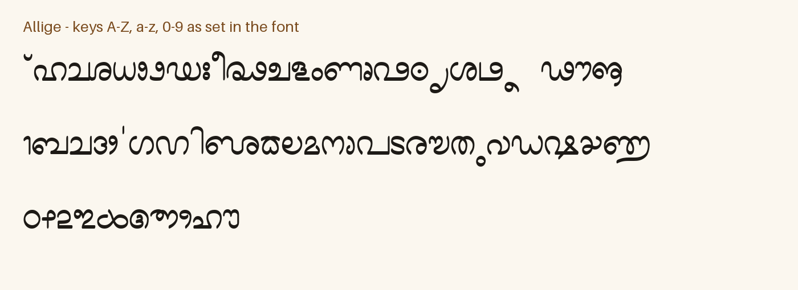

<h1 align="center">Allige</h1>
<p align="center"><em>Academy edition, v1.4.</em></p>



Allige is a compact Tulu lipi font; this is the Academy edition, version 1.4. The logo is below.

| | |
|---|---|
| **Designer** | Prahlad Prasad Tantry |
| **Format** | TrueType, `.ttf` |
| **Glyphs** | 134 |
| **Year** | 2022 |
| **License** | [SIL OFL 1.1](OFL.txt) |
| **Family** | [Tantry Tulu Font Foundry](https://github.com/TantryTuluFonts) |

## Get the font

Download the latest build from the [Releases page](https://github.com/TantryTuluFonts/allige/releases/latest), or take `fonts/XAAlAlieg(allige)Academy1.4.ttf` straight from this repository.

- **Windows:** right-click the file and choose *Install for all users*.
- **macOS:** open the file and click *Install Font*.
- **Linux:** copy it to `~/.local/share/fonts/` and run `fc-cache -f`.

## How to type with Allige

Allige is key-mapped: it places Tulu lipi glyphs on the Latin keys, so you type with an ordinary keyboard and the font draws the Tulu forms. The specimen above shows what each key produces. Because the text is stored as Latin characters, it only reads as Tulu while Allige is applied; paste it somewhere with a different font and it will show as plain Latin letters. Keep that in mind for search, sharing and archiving.

<p align="center"></p>

## Use on the web

```css
@font-face {
  font-family: "Allige";
  src: url("fonts/XAAlAlieg(allige)Academy1.4.ttf");
  font-display: swap;
}
.tulu { font-family: "Allige", sans-serif; }
```

## License and credit

Allige is free software under the [SIL Open Font License 1.1](OFL.txt): use it in print, on screens or in products, study it, and make your own versions, as long as the font is not sold on its own and derivatives stay under the same license. Please keep the credit **Prahlad Prasad Tantry** when you share it. Full history is in the [FONTLOG](FONTLOG.md).

Questions or specimens to show off? [Open an issue](https://github.com/TantryTuluFonts/allige/issues).
